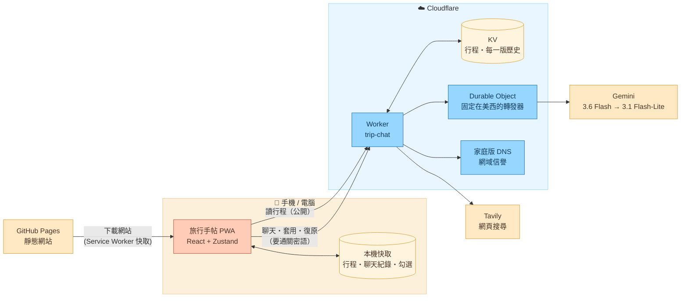
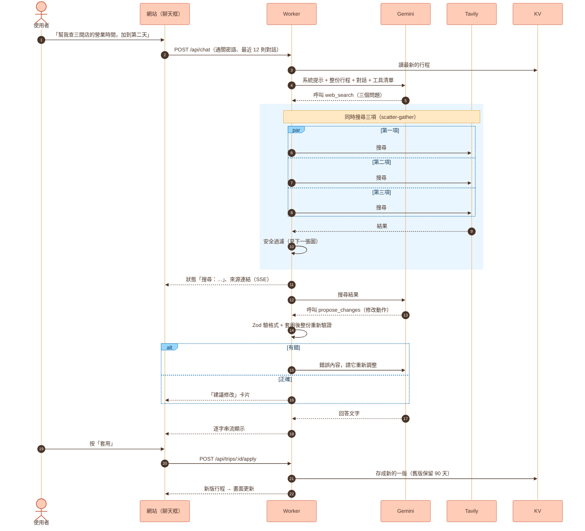
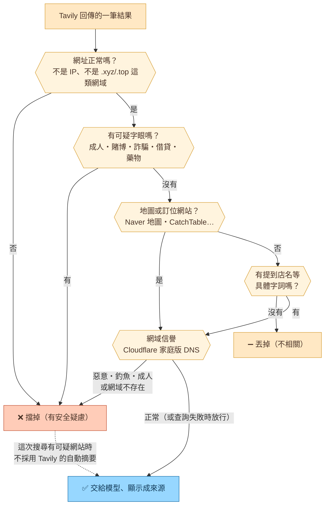
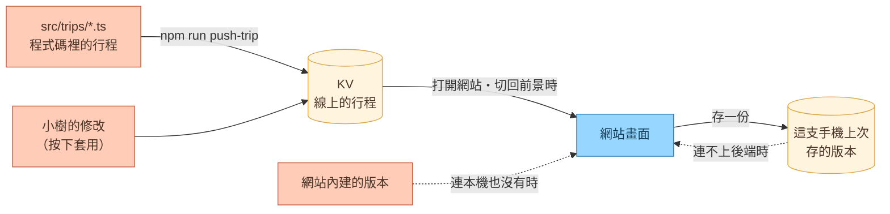

# 旅行手帖

手機優先的旅遊行程表，加上一個會上網查資料、能幫忙改行程的 AI 小幫手「小樹」。

- 網站：<https://henry190927.github.io/trip-planner/>（PWA，可加到主畫面、離線開啟）
- 前端：Vite + React + TypeScript + Tailwind，放在 GitHub Pages
- 後端：Cloudflare Worker（行程資料、AI 對話），AI 用 Gemini，搜尋用 Tavily

## 系統架構



幾個刻意的設計：

- **行程是共用的，對話是各自的**：按下「套用」的修改存在後端，兩支手機都看得到；聊天紀錄只存在自己的手機。
- **AI 只能改資料，不能改介面**：AI 送出的是幾種固定的「修改動作」，介面永遠是同一套。
- **人工確認**：AI 的修改不會直接生效，要使用者按「套用」；每一版都保留，可以復原。
- **離線也能看**：行程依序從後端 → 這支手機上次存的版本 → 網站內建的版本讀取。

## AI 小幫手怎麼運作

一輪對話是個小迴圈（最多 6 步）：模型決定要不要搜尋、要不要提出修改，Worker 執行後把結果交回給模型，直到它寫出回答。



AI 能做的修改只有這幾種（定義在 `src/schema.ts` 的 `opSchema`）：
新增 / 修改 / 刪除行程項目、加清單項目、加 / 移除待確認事項。

### 搜尋結果的安全過濾

垃圾、詐騙、賭博、成人網站常在頁面塞滿熱門店名，搜尋結果偶爾會混進來。每筆結果要通過這幾關，才會交給模型、顯示成來源按鈕（`worker/safety.ts`）：



### 免費方案的限制與對策

| 限制 | 對策 |
|---|---|
| Gemini 不支援香港，而從台灣連線常被分到 Cloudflare 香港機房 | 對 Gemini 的請求都經過固定在美西的 Durable Object 轉發（`worker/relay.ts`） |
| 每個模型每天只有 20 次請求，常塞車（503） | 主模型 3.6 Flash；503 先等 1.5 秒重試，再改用 3.1 Flash-Lite（額度分開算） |
| Gemini 內建的 Google 搜尋在免費方案沒有額度 | 改用 Tavily（每月 1,000 次）；結果直接交給模型讀，不多用 Gemini 額度 |
| 一次要查好幾件事 | 同一次呼叫最多 4 項同時搜尋，各自逾時，部分失敗也會標出來 |

## 資料怎麼流動



⚠️ 線上的行程以 KV 為準。直接改了 `src/trips/` 的行程檔之後，要跑一次 `push-trip` 才會上線（舊版一樣保留、可以復原）：

```bash
APP_PASSCODE=<通關密語> npm run push-trip -- seoul-2026-11
```

## 開發

```bash
npm install
npm run dev      # 終端機會印出 Network 網址，手機連同一個 Wi-Fi 就能開
npm run build    # 產出 dist/
npm run check    # oxlint + 型別（前端與 Worker）+ 單元測試（CI 部署前也會跑）
npm run test:e2e # Playwright，用本機 Chrome 以 iPhone 尺寸跑，截圖在 e2e/screenshots/
```

本機開發時一樣連線上的 Worker（網址在 `.env` 的 `VITE_API_BASE`），Worker 允許 localhost 與區網 IP 呼叫。

### 專案結構

```
src/
  schema.ts         資料格式的唯一來源（Zod）：行程、AI 的修改動作
  trips/            每趟旅行的資料
  lib/
    ops.ts          套用 AI 的修改動作
    validate.ts     整份行程的完整性檢查（時間排序、路線連結、旅伴 id…）
    tripStore.ts    行程從哪裡讀：後端 → 本機快取 → 內建
    chatStore.ts    聊天紀錄、串流、套用與復原
  components/       畫面（ChatSheet 是聊天框，illustrations 是手繪插圖）
worker/
  index.ts          API 路由、通關密語、CORS
  agent.ts          對話迴圈、工具定義、系統提示
  gemini.ts         呼叫 Gemini（串流、重試、備用模型）
  relay.ts          固定在美西的轉發器
  search.ts         Tavily 搜尋與同時查多項
  safety.ts         搜尋結果的安全過濾
  store.ts          KV：行程與每一版歷史、復原
scripts/push-trip.ts  把程式碼裡的行程推上線
```

## 技術選擇

Vite 8 + React + TypeScript + Tailwind CSS v4，動畫用 Motion。另外用了：

- **Zod**：`src/schema.ts` 是資料格式的唯一來源，前端型別從它推導；Worker 用它驗證 AI 送來的修改
- **Zustand**：行程、聊天紀錄、「看誰的行程」與清單勾選
- **Cloudflare Worker + KV + Durable Object**：免費方案就夠兩個人用
- **Vitest / Playwright / Oxlint**：單元測試、手機尺寸 e2e、lint

刻意沒用：Next.js（純靜態、不需要 SSR）、TanStack Router（只有四個分頁，30 行的 hash router 就夠）、TanStack Query / MSW（只有幾支 API，Zustand 就能管）、shadcn/ui（介面全是自製插畫風元件）、Storybook、Sentry（兩個人用，成本大於效益）。

## 新增一趟旅行

1. 複製 `src/trips/seoul-2026-11.ts` 成新檔（例如 `nagoya-2026-12.ts`），依 `src/types.ts` 的 `Trip` 格式填資料
2. 在 `src/trips/index.ts` 的 `trips` 陣列加進去（並從 `upcoming` 拿掉）
3. `npm run check`：資料寫錯（時間沒排序、routeId 打錯、旅伴 id 不存在）會在這裡被擋下
4. `npm run deploy:worker`：Worker 把 `src/trips/` 打包進去當新行程的初始版本，重新部署後端才有這趟旅行

介面不用改。每趟旅行自己決定時區（`timezone`）、地圖 App（`mapProvider`）、旅伴（`travelers`，可以讓某些項目只屬於某個人）、每天的插圖（`scene`）。

## 部署

- **網站**：push 到 `main` 後，GitHub Actions 會跑 `npm run check`、build，再發布到 GitHub Pages
  （repo 的 Settings → Pages → Source 要選「GitHub Actions」）
- **Worker**：`npm run deploy:worker`。機密設定用 `npx wrangler secret put <名稱>` 設定，不寫進程式碼：
  `GEMINI_API_KEY`、`TAVILY_API_KEY`、`APP_PASSCODE`

⚠️ GitHub Pages 是公開網址：不要放訂位代號、護照號碼這類資料。
