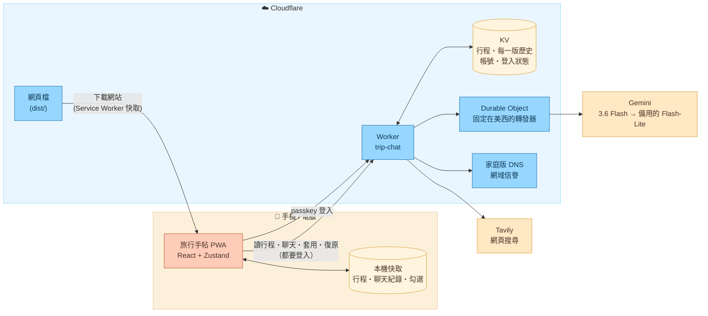
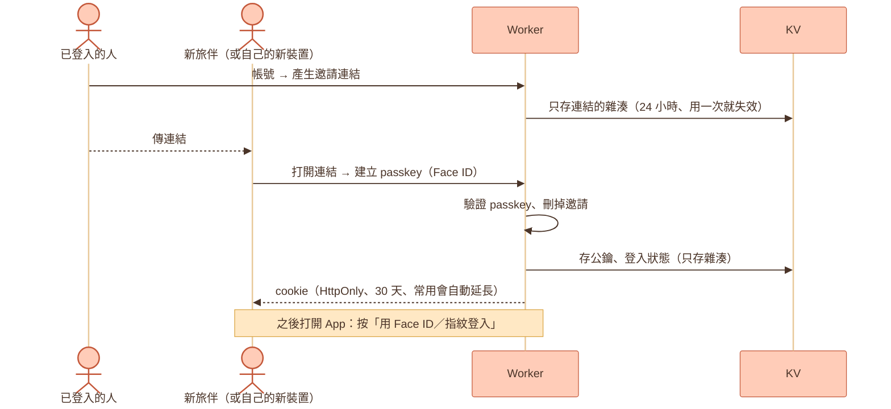
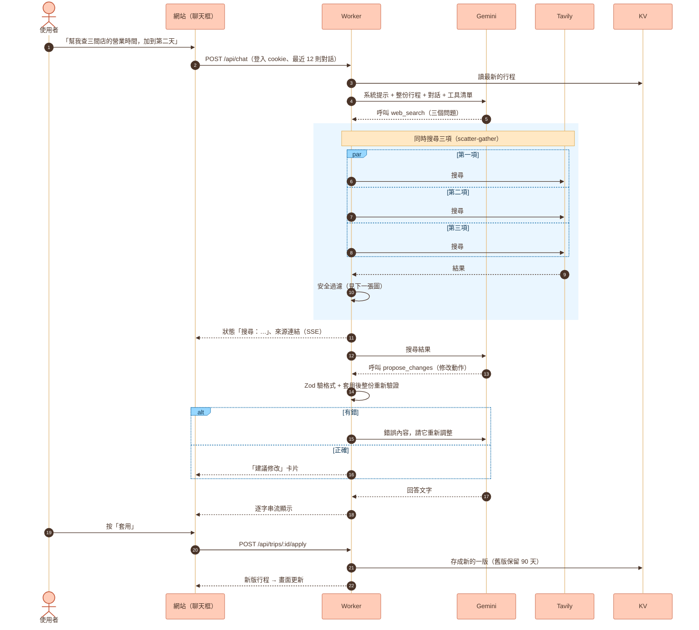
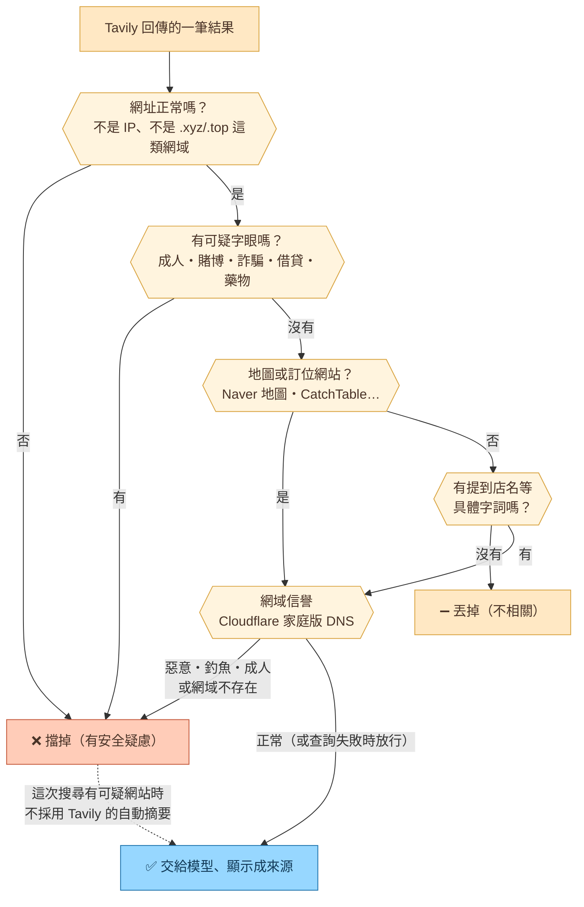
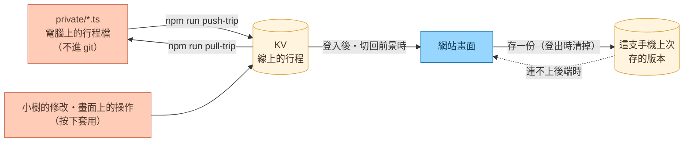

# 旅行手帖

手機優先的旅遊行程表，加上一個會上網查資料、能幫忙改行程的 AI 小幫手「小樹」。

- 網站：<https://trip-chat.travel-planner-hm1d.workers.dev>（PWA，可加到主畫面、離線開啟；要登入）
- 前端：Vite + React + TypeScript + Tailwind
- 後端：Cloudflare Worker（網站、登入、行程資料、AI 對話），AI 用 Gemini，搜尋用 Tavily
- 登入：passkey（Face ID／指紋），沒有密碼

**程式碼公開，資料不公開。** 這個 repo 裡沒有任何真實的行程；行程、修改紀錄、帳號都只存在 Cloudflare KV，登入才拿得到。
`test/fixtures/` 裡的行程是測試用的資料（住宿、航班是假的）。

## 系統架構



幾個刻意的設計：

- **行程是共用的，對話是各自的**：按下「套用」的修改存在後端，兩支手機都看得到；聊天紀錄只存在自己的手機。
- **AI 只能改資料，不能改介面**：AI 送出的是幾種固定的「修改動作」，介面永遠是同一套。
- **人工確認**：AI 的修改不會直接生效，要使用者按「套用」；每一版都保留，可以復原。
- **離線也能看**：登入過的手機會存一份最新的行程，連不上網路時先用那份；登出時清掉。
- **網站和 API 同一個網址**：登入狀態放在 JavaScript 讀不到的 cookie（`HttpOnly`、`SameSite=Strict`），不用跨網域傳。

## 登入與資料保護

每個人用 passkey 登入：手機上的 Face ID／指紋確認是本人，私鑰留在裝置裡（Apple 裝置之間由 iCloud 鑰匙圈同步）。
沒有密碼可以外洩、也沒辦法被釣魚網站騙走（passkey 綁定這個網址），所以不另外做簡訊或驗證碼的兩步驟驗證。



- **除了登入相關的端點，API 都要登入**；會改東西的請求另外檢查 `Origin`，只接受網站本身送來的。
- **手機遺失**：從另一台裝置的「帳號」移除它，用它登入的狀態立刻失效。
- **兩個人的手機都不見**：在電腦上 `npm run users` 找到帳號 id，`npm run invite -- --user <id>` 產生恢復用的邀請連結（用你自己登入的 wrangler 寫進 KV，不經過網站）。
- **變動紀錄記下是誰改的**，鈴鐺裡看得到。
- 網頁帶著 Content-Security-Policy 等安全標頭（`public/_headers`）。

## AI 小幫手怎麼運作

一輪對話是個小迴圈（最多 6 步）：模型決定要不要搜尋、要不要提出修改，Worker 執行後把結果交回給模型，直到它寫出回答。



AI 能做的修改只有這幾種（定義在 `src/schema.ts` 的 `opSchema`）：
新增 / 修改 / 刪除行程項目、加清單項目、加 / 移除待確認事項。

### 搜尋結果的安全過濾

垃圾、詐騙、賭博、成人網站常在頁面塞滿熱門店名，搜尋結果偶爾會混進來。每筆結果要通過這幾關，才會交給模型、顯示成來源按鈕（`worker/safety.ts`）：



### 免費方案的限制與對策

| 限制 | 對策 |
|---|---|
| Gemini 不支援香港，而從台灣連線常被分到 Cloudflare 香港機房 | 對 Gemini 的請求都經過固定在美西的 Durable Object 轉發（`worker/relay.ts`） |
| 每個模型每天只有 20 次請求，常塞車（503） | 主模型 3.6 Flash；503 先等 2 秒重試一次，再依序改用幾個 Flash-Lite（每個模型的額度分開算，見 `wrangler.jsonc` 的 `FALLBACK_MODELS`） |
| Gemini 內建的 Google 搜尋在免費方案沒有額度 | 改用 Tavily（每月 1,000 次）；結果直接交給模型讀，不多用 Gemini 額度 |
| 一次要查好幾件事 | 同一次呼叫最多 4 項同時搜尋，各自逾時，部分失敗也會標出來 |

## 資料怎麼流動



⚠️ 線上的行程以 KV 為準。要用電腦上的檔案整份取代之前，一定先拉最新版下來對照，不然 App 裡改過的內容會被蓋掉（被蓋掉的版本仍保留、可以復原）：

```bash
npm run pull-trip -- busan-2026-12                       # 存到 private/busan-2026-12.json
npm run push-trip -- private/busan-2026-12.json --replace
```

## 開發

```bash
npm install
npm run dev      # 終端機會印出 Network 網址，手機連同一個 Wi-Fi 就能開
npm run build    # 產出 dist/
npm run check    # oxlint + 型別（前端與 Worker）+ 單元測試（CI 也會跑）
npm run test:e2e # Playwright，用本機 Chrome 以 iPhone 尺寸跑（後端用 page.route 模擬），截圖在 e2e/screenshots/
npm run test:auth # 登入的端對端測試：本機的 Worker + 暫存 KV + Chrome 的虛擬 passkey，不碰線上資料
```

本機開發：另開一個終端機跑 `npx wrangler dev`（本機的 Worker 與 KV），`npm run dev` 會把 `/api` 轉過去。
本機 KV 是空的：用 `KV_LOCAL=.wrangler/state npm run push-trip -- <行程檔>` 放一份行程、`KV_LOCAL=.wrangler/state npm run invite -- <名字>` 產生邀請連結（`SITE_URL=http://localhost:5173`）。

### 專案結構

```
src/
  schema.ts         資料格式的唯一來源（Zod）：行程、AI 的修改動作
  lib/
    ops.ts          套用 AI 的修改動作
    validate.ts     整份行程的完整性檢查（時間排序、路線連結、旅伴 id…）
    tripStore.ts    行程：後端 → 本機快取（離線用）
    authStore.ts    登入狀態、passkey 登入與加入
    chatStore.ts    聊天紀錄、串流、套用與復原
  components/       畫面（ChatSheet 是聊天框，illustrations 是手繪插圖）
worker/
  index.ts          API 路由（網頁檔以外的 /api/*）
  auth.ts           passkey 登入、邀請連結、登入狀態
  agent.ts          對話迴圈、工具定義、系統提示
  gemini.ts         呼叫 Gemini（串流、重試、備用模型）
  relay.ts          固定在美西的轉發器
  search.ts         Tavily 搜尋與同時查多項
  safety.ts         搜尋結果的安全過濾
  store.ts          KV：行程與每一版歷史、復原
scripts/              用你登入的 wrangler 直接讀寫線上 KV
  push-trip.ts      把電腦上的行程檔放上線（建立或取代）
  pull-trip.ts      把線上最新版存到 private/
  invite.ts         產生邀請連結（第一次設定、或恢復用）
  users.ts          列出帳號與裝置
test/fixtures/      測試用的行程
private/            真實的行程檔與備份（.gitignore，不進 git）
```

## 技術選擇

Vite 8 + React + TypeScript + Tailwind CSS v4，動畫用 Motion。另外用了：

- **Zod**：`src/schema.ts` 是資料格式的唯一來源，前端型別從它推導；Worker 用它驗證 AI 送來的修改
- **Zustand**：登入狀態、行程、聊天紀錄、「看誰的行程」
- **SimpleWebAuthn**：passkey 的註冊與驗證（前端呼叫瀏覽器、Worker 驗簽章）
- **Cloudflare Worker + KV + Durable Object**：網站、API、資料都在同一個 Worker，免費方案就夠兩個人用
- **Vitest / Playwright / Oxlint**：單元測試、手機尺寸 e2e、lint

刻意沒用：Next.js（純靜態、不需要 SSR）、TanStack Router（只有四個分頁，30 行的 hash router 就夠）、TanStack Query / MSW（只有幾支 API，Zustand 就能管）、shadcn/ui（介面全是自製插畫風元件）、Storybook、Sentry（兩個人用，成本大於效益）。

## 新增一趟旅行

1. 在 `private/` 建一個行程檔（例如 `private/busan-2026-12.ts`，`export default` 一個 `Trip`），格式見 `src/schema.ts`；可以參考 `test/fixtures/seoul-2026-11.ts`
2. `npm run push-trip -- private/busan-2026-12.ts`：先檢查格式與完整性（時間排序、routeId、旅伴 id），通過才建立
3. 打開 App 就看得到；之後在 App 裡或請小樹修改

介面不用改。每趟旅行自己決定時區（`timezone`）、地圖 App（`mapProvider`）、旅伴（`travelers`，可以讓某些項目只屬於某個人）、每天的插圖（`scene`）。

## 部署

```bash
npm run deploy   # build 網站，連同 Worker 一起部署到 Cloudflare
```

- 機密設定用 `npx wrangler secret put <名稱>` 設定，不寫進程式碼：`GEMINI_API_KEY`、`TAVILY_API_KEY`
- push 到 `main` 時 GitHub Actions 會跑 `npm run check`（只檢查，不部署）

### 自己架一份

1. Fork 這個 repo，`npm install`
2. `npx wrangler kv namespace create TRIPS`，把 id 換進 `wrangler.jsonc`
3. 設定上面兩個機密，`npm run deploy`
4. `npm run invite -- <你的名字>` 產生第一個邀請連結，在手機上打開、建立 passkey
5. `npm run push-trip -- <行程檔>` 放進第一趟旅行
